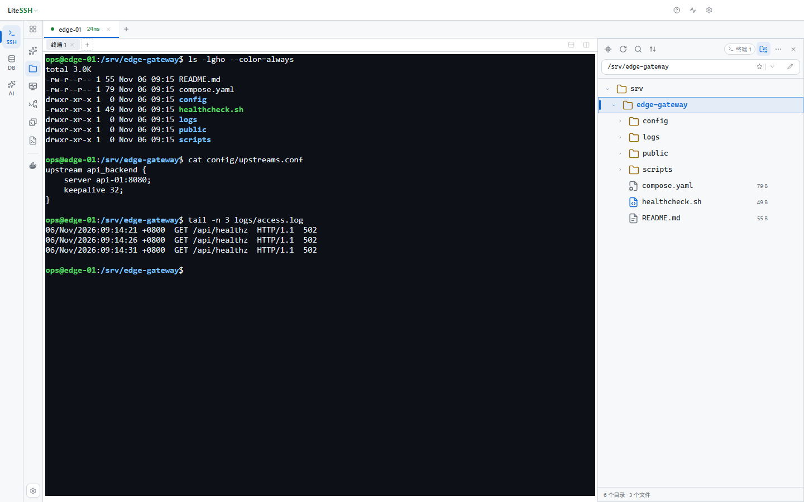
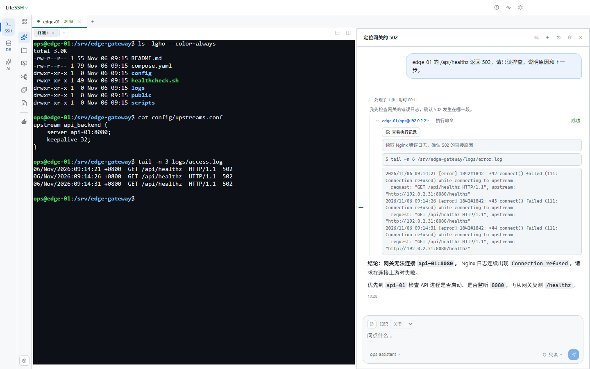
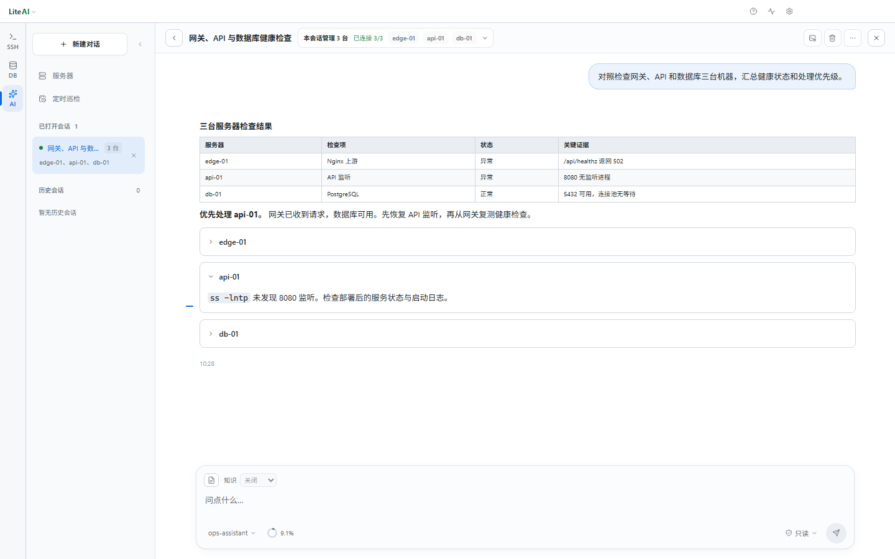
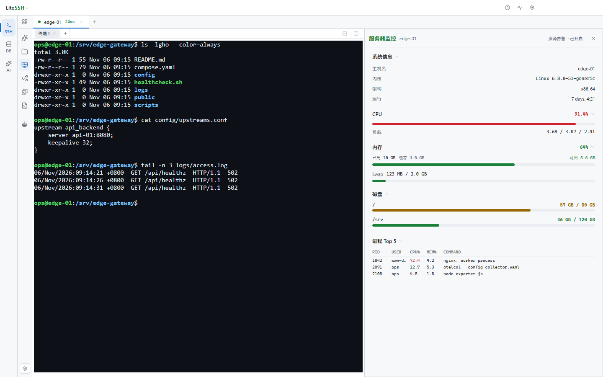
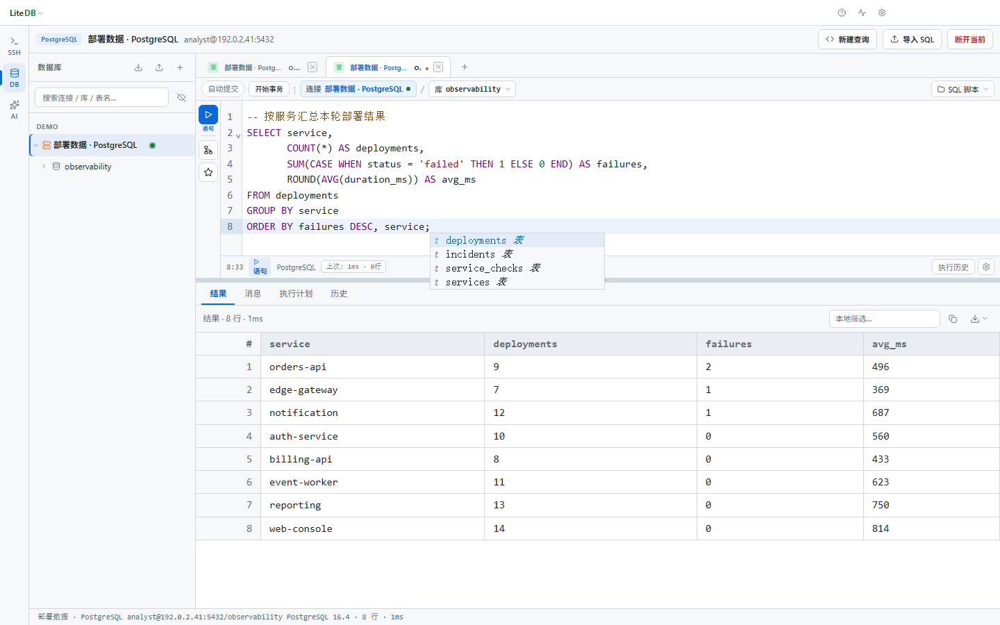

<h1 align="center">LiteConnect</h1>

<p align="center"><strong>连上服务器，剩下的在一个窗口里做完。</strong></p>

<p align="center">一条 SSH 连接驱动终端、文件传输、服务器监控、Docker 与数据库，也让 AI 拿着真实的命令输出来和你一起排障。面向开发者与运维人员的开源跨平台客户端。</p>

<p align="center">
  <a href="https://github.com/wat4me/LiteConnect/releases/latest"></a>
  <a href="LICENSE"></a>
  <a href="https://github.com/wat4me/LiteConnect/releases"></a>
</p>

<p align="center">
  <a href="https://github.com/wat4me/LiteConnect/releases/latest">下载最新版本</a> ·
  <a href="docs/AI.md">AI 使用指南</a> ·
  <a href="docs/SSH.md">SSH 使用指南</a> ·
  <a href="docs/DEVELOPMENT.md">开发指南</a>
</p>

## 一条连接，一整套工作流



> 截图使用演示数据。终端输出和 SQL 结果由本地样例实际运行生成，AI 对话与监控指标为演示样例。

登录一台服务器之后，你不必再为文件传输、监控和 Docker 分别配置一次跳板机与凭据：它们复用你刚建立的那条 SSH 会话，终端、文件面板和工具区共用同一个工作区，来回切换不重连。

- **终端**：多标签、分屏对照、批量执行，以及「同步输入」——一次输入广播到你选中的多台终端。
- **连接**：分组管理，密码 / 私钥 / SSH Agent 认证，跳板机、端口转发与 X11；断线后按指数退避自动重连，每个终端独立计数。
- **布局**：工具图标可以停靠到左右两侧、拖动排序并锁定，布局对所有 SSH 连接生效。
- **会话日志**：独立落盘并处理磁盘背压，日志写不下去时终端不受影响。

## 文件、数据与容器，都在手边

**SFTP** 拖拽即传，目录递归处理，支持断点续传；只有真的遇到同名文件才暂停询问，可选择保留两份、覆盖或跳过，并应用到本批后续冲突。远端文件可直接编辑、改权限。

**数据库** 支持 MySQL、PostgreSQL 与 Oracle，可经 SSH 隧道连接，自带 SQL 编辑器、分页浏览、单元格编辑与导出。

**服务器状态** 把 CPU、内存、磁盘、进程与主机信息收在一个面板里，可按服务器配置资源告警。

**Docker** 复用同一条 SSH 会话查看容器、日志与配置，启停容器或直接打开交互式终端。

## AI 拿着真实的输出来排障

可以直接把终端选区或上下文发给它，也可以提出这样的任务：

- 「找出磁盘占用最多的目录。」
- 「定位这份日志中的错误，并解释可能原因。」
- 「检查这组应用、数据库和网关服务器，汇总异常。」
- 「解释当前配置，并给出修改建议。」

AI 能查询系统状态、检索文件、读取日志、运行命令、执行后台任务，也会在对话里发起文件上传下载。工具过程与结果完整留在时间线中：每张卡片标明目标服务器、命令、状态，以及分别保存的标准输出与错误输出；长输出明确标记截断，失败不会被显示成成功。



独立的 **LiteAI 工作区**支持按分组勾选 1 至 20 台服务器协同查询，回答先给跨服务器汇总表，再按主机展开细节；服务器知识（关闭 / 只读 / 可更新）、图片附件、长会话上下文压缩与 Token 用量统计也在这里。后台命令与 AI 上传下载共用同一个可拖动的任务入口。



### 操作边界清晰可见

| 权限模式 | 行为 |
|---|---|
| 只读自动，修改需确认（默认） | 只读操作自动执行；修改和提权暂停并等待允许 |
| 只允许只读 | 仅执行申报为只读的调用，拒绝修改和提权 |
| 自动执行 | 合法申报的操作可自动执行；明确高危命令仍需确认 |

权限模式同时参考 AI 申报的级别和应用对命令的独立判级。审批绑定具体请求与 SSH 会话，拒绝、取消或超时后，未获批准的调用不会执行。

> 「只允许只读」不是系统级只读隔离，远端操作仍受 SSH 登录账号的实际权限约束。对话内容和用于分析的工具结果会发送到你配置的模型提供商。

### 让巡检替你值夜班

选 1 至 10 台已保存的服务器，按间隔、每天或每周执行一次只读巡检，也可以随时手动跑一次。多机巡检可串行或最多 5 台并行，每台使用专用连接和独立 AI 上下文，结束后交出差异、共同异常与处理优先级；一台失败不影响其余主机。

结果能通过通用 JSON Webhook 推送到飞书、钉钉等接收端，可选择只在异常、失败或「需复核」时通知，也可以每次结束都通知。定时巡检强制只读，不继承交互会话的自动修改权限。

## 服务器监控与 SQL 查询





## 也可以交给你已有的 AI 客户端

LiteConnect 提供可选的本机 MCP 服务，把你保存的连接、命令、文件和监控能力开放给支持 **MCP Streamable HTTP** 的第三方客户端。

**服务默认关闭，仅监听本机 loopback，LiteConnect 必须保持运行。**

1. 打开「设置 → MCP」，启用服务并完成确认。
2. 复制服务地址和 Bearer Token。
3. 在同一台电脑上支持 MCP Streamable HTTP 的客户端中添加服务。

```json
{
  "name": "liteconnect-ssh",
  "transport": "http",
  "url": "http://127.0.0.1:17420/mcp",
  "headers": {
    "Authorization": "Bearer <token>"
  }
}
```

| 项目 | 内置 AI | 外部 MCP 客户端 |
|---|---|---|
| 模型配置 | 在 LiteConnect 中配置 | 由外部客户端管理 |
| 需要开启 MCP 服务 | 否 | 是 |
| 主机范围 | 当前主机或 LiteAI 选定范围 | 可发现、连接多个主机并广播命令 |
| 操作控制 | 按权限模式自动执行或请求审批 | 默认 `deny-destructive` 命令策略 |

内置 AI 的侧栏**不需要开启 MCP 服务**；反过来，修改内置 AI 的权限模式也不会放开 MCP 的默认策略。MCP 会拒绝被分类为破坏性、提权或高危的命令，但这不等同于整个服务只读，文件写入、传输和连接管理等工具仍在开放范围内。

仅把 Token 配置给可信的本机客户端，不要提交到仓库、公开分享或配置给远程 Agent。网页版 AI 客户端通常无法访问本机 `127.0.0.1` 服务。

使用 AI 操作服务器时，所选模型需要支持工具调用。更多配置、图片输入、上下文压缩与任务说明见 [AI 使用指南](docs/AI.md)。

## 下载与安装

从 [GitHub Releases](https://github.com/wat4me/LiteConnect/releases/latest) 下载适合当前系统的安装包：

| 平台 | 安装包 |
|---|---|
| Windows | NSIS 安装程序 |
| macOS | DMG / ZIP |
| Linux | AppImage / DEB |

> **注意**：安装包尚未签名。Windows 可能出现 SmartScreen 提示，macOS 可能需要右键选择「打开」。

## 快速开始

1. **新建连接**：添加 SSH 或数据库连接，填写地址与认证信息。
2. **进入工作区**：打开终端，或切换到 SFTP、监控、Docker 与 SQL 工具。
3. **按需启用 AI**：在 AI 设置中配置 OpenAI 兼容或 Anthropic Messages 提供商，然后开始提问。

## 本地数据与安全

- 连接配置、应用设置、命令与查询历史、AI 对话和 MCP 审计记录保存在本机 SQLite 数据库中。
- Windows 默认数据目录为 `%APPDATA%\lite-connect\`。
- 主机密钥使用本地 `known_hosts` 管理；首次连接展示 SHA256 指纹，密钥变化时对比新旧指纹并要求确认。
- 连接配置支持导入导出；密码、私钥和数据库密码在系统加密服务可用时加密保存。
- 应用运行时不要单独复制或删除 SQLite WAL / SHM 文件；旧版迁移备份会保留为 `*.pre-sqlite-v1.bak`。

## 当前边界

- Docker 模块暂不包含删除容器、镜像管理、Volume 管理或 Compose。
- MCP 不提供 Docker socket 或数据库隧道的专用工具。
- Oracle 表数据分页适用于 Oracle 12c 及以上版本。
- 监控字段取决于远端操作系统和可用命令；后台资源告警默认关闭。

## 开发与贡献

建议使用 Node.js 22 和 npm 9 或更高版本：

```bash
npm ci
npm run dev
```

源码结构、测试、构建与发版步骤见 [开发指南](docs/DEVELOPMENT.md)，模块职责与依赖边界见 [架构说明](ARCHITECTURE.md)。

## 致谢

本项目认可并感谢 [LINUX DO](https://linux.do) 社区。

## 许可

[GNU General Public License v3.0](LICENSE)
